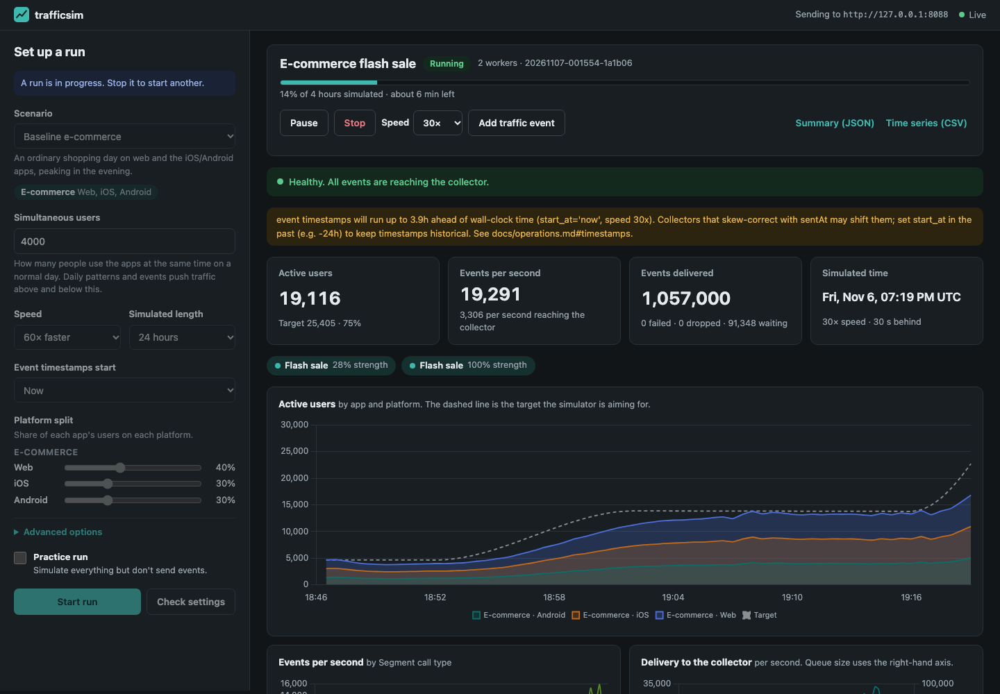
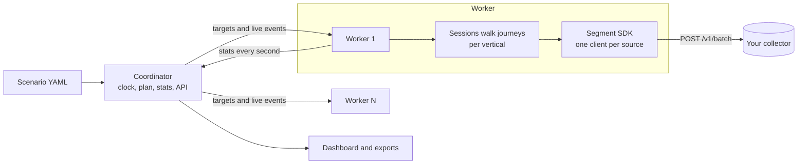

# trafficsim

[](https://github.com/jaydeep-punjani/traffic-simulator/actions/workflows/ci.yml)
[](https://github.com/jaydeep-punjani/traffic-simulator/actions/workflows/codeql.yml)
[](https://github.com/jaydeep-punjani/traffic-simulator/releases)
[](docs/compatibility.md#runtime-support)
[](LICENSE)

Simulate realistic app traffic for **video streaming**, **e-commerce** and **gaming** products, and send it as real
analytics events through the open-source [Segment SDK](https://github.com/segmentio/analytics-python) to any
Segment-compatible collector: Segment, RudderStack, Jitsu, your own endpoint, or the bundled mock.

Use it to load-test an event pipeline, fill a warehouse with believable data, demo dashboards, or rehearse a launch
day before it happens.



## What it does

- **Thousands to 100k+ concurrent users**, each with a session that follows a journey: browsing, watching, carts and
  checkout, matchmaking and matches.
- **Traffic patterns** you can stack: daily and weekly cycles per region, ramps, steps, spikes, sine waves and custom
  curves.
- **Scenario events**: premieres, live events, flash sales, Black Friday, push campaigns, game launches, patch days
  and tournaments. Schedule them in a scenario or fire them live from the dashboard.
- **Real time or accelerated** (60x plays an hour per minute), with event timestamps on the simulated clock and an
  anchor you choose (now, yesterday, last week).
- **Live dashboard** with charts and delivery health, plus JSON / CSV exports. Every event is accounted for: sent,
  failed, dropped or undelivered, never silently lost.

| Vertical | Platforms | Events follow |
|---|---|---|
| Video streaming | Web, iOS, Android | [Segment Video Spec](https://www.twilio.com/docs/segment/connections/spec/video) |
| E-commerce | Web, iOS, Android | [Segment E-commerce Spec v2](https://www.twilio.com/docs/segment/connections/spec/ecommerce/v2) |
| Gaming | PC, PS5 | A custom game event set in Segment naming style |

Event names, journeys and properties live in YAML, so you can rename events or reshape journeys without touching code.

## What it sends

Every event goes through `segment-analytics-python` to `POST {host}/v1/batch`, exactly like a production server
would send it. Each message's `context` matches the platform it pretends to come from, including the Segment client
library that platform would use:

| Platform | `context.library.name` | Calls |
|---|---|---|
| Web | `analytics.js` | `page`, `track`, `identify`, `alias` |
| iOS | `analytics-swift` | `screen`, `track`, `identify`, `alias` |
| Android | `analytics-kotlin` | `screen`, `track`, `identify`, `alias` |
| PC, PS5 | `Analytics-CSharp` | `screen`, `track`, `identify`, `alias` |

<details>
<summary>Example: <code>Video Playback Started</code> from the iOS app</summary>

```json
{
  "type": "track",
  "event": "Video Playback Started",
  "properties": {
    "session_id": "22f08a19-2",
    "content_asset_ids": ["cnt-00003"],
    "content_pod_ids": ["pod-cnt-00003-0"],
    "position": 0,
    "total_length": 5880,
    "bitrate": 1500,
    "framerate": 24,
    "video_player": "AVPlayer",
    "sound": 66,
    "full_screen": true,
    "ad_enabled": false,
    "quality": "720p",
    "livestream": false
  },
  "userId": "st_d0c7fd6daf8243c1943f",
  "anonymousId": "22f08a19-0bbb-4e85-b998-07cd8538604e",
  "timestamp": "2026-01-01T00:00:57.779+00:00",
  "context": {
    "library": {"name": "analytics-swift", "version": "1.10.4"},
    "app": {"name": "StreamFlix", "version": "8.12.0", "build": "81200", "namespace": "com.streamflix.ios"},
    "device": {"id": "721b4e1e-…", "advertisingId": "2C189733-…", "adTrackingEnabled": false,
               "manufacturer": "Apple", "model": "iPhone14,7", "name": "iPhone 14", "type": "ios"},
    "os": {"name": "iOS", "version": "18.0.1"},
    "network": {"wifi": false, "cellular": true, "bluetooth": false, "carrier": "AT&T"},
    "screen": {"width": 1170, "height": 2532, "density": 3},
    "ip": "32.166.8.27", "locale": "en-US", "timezone": "America/Chicago",
    "userAgent": "StreamFlix/8.12.0 (iPhone; iOS 18.0.1; Scale/3.00)"
  }
}
```

The SDK adds `messageId` and wraps messages in a batch with `sentAt` and `writeKey`.
</details>

Spec coverage, per-platform context fields, payload sizes and collector support are measured and listed in
**[docs/compatibility.md](docs/compatibility.md)**.

## Quick start

### Docker (no Python needed)

```bash
git clone https://github.com/jaydeep-punjani/traffic-simulator.git && cd traffic-simulator
docker compose up -d --build        # dashboard on http://127.0.0.1:8000, mock collector on :8088
```

Open <http://127.0.0.1:8000>, pick a scenario and press **Practice run** (nothing is sent) or **Start** (events go to
the bundled mock collector). Or run one headless:

```bash
docker compose run --rm sim run ecom_flash_sale --max-wall 60
curl -s http://127.0.0.1:8088/stats   # what the collector received
```

Released images are also on GHCR: `docker run --rm -p 127.0.0.1:8000:8000 ghcr.io/jaydeep-punjani/traffic-simulator`.
See [docs/docker.md](docs/docker.md).

### Python

Requires Python 3.10 or newer.

```bash
git clone https://github.com/jaydeep-punjani/traffic-simulator.git && cd traffic-simulator
python -m venv .venv && source .venv/bin/activate
pip install -e .

trafficsim mock-collector                       # terminal 1: Segment-compatible endpoint on :8088
trafficsim serve                                # terminal 2: dashboard on http://127.0.0.1:8000
trafficsim run ecom_flash_sale --max-wall 60    # or run headless
```

### Send to your collector

```bash
export SEGMENT_HOST=https://your-collector.example.com   # the SDK posts to $SEGMENT_HOST/v1/batch
export SEGMENT_WRITE_KEY=...                              # or one key per source, e.g. ECOM_IOS_WRITE_KEY
trafficsim run mixed_all --start-at -24h
```

Write keys can be set per source (vertical × platform). Keep them in the environment or in the gitignored
`config/destinations.yaml`; see [operations.md#destinations](docs/operations.md#destinations).

## Common commands

```bash
trafficsim list                                    # bundled scenarios
trafficsim validate                                # check every scenario (or one: trafficsim validate my.yaml)
trafficsim run baseline_streaming --dry-run        # simulate without sending
trafficsim run mixed_all --speed 120 --concurrency 20000 --start-at -24h --set verticals.gaming.weight=0.5
trafficsim run stress_100k --workers 10            # 100k concurrent users at 60x
trafficsim --help                                  # everything else
```

Each run writes `runs/<run-id>/summary.json` and `timeseries.csv`, and optionally a sample of the exact payloads.

## Scenarios

A scenario is a YAML file in `scenarios/`. Bundled ones:

| Scenario | What happens |
|---|---|
| `baseline_streaming`, `baseline_ecom`, `baseline_gaming` | A normal day for one vertical |
| `streaming_premiere` | A series premiere pulls viewers to one title, then a live sports final |
| `ecom_flash_sale` | A one-hour flash sale with a conversion boost, then a mobile push campaign |
| `ecom_black_friday` | Four days of Black Friday traffic, replayed into the past at 240x |
| `gaming_launch_day` | A game launch: installs, tutorials, first matches |
| `gaming_tournament` | A patch-day login spike, then a 4-hour tournament that floods matchmaking |
| `mixed_all` | All three verticals together, one scenario event each |
| `stress_100k` | 100k concurrent users at 60x |

A small scenario:

```yaml
name: Launch day
start_at: -24h           # now | -24h | 2026-11-27T00:00:00Z
duration: 12h
speed: 60                # 1 = real time
seed: 42                 # same seed, same users and journeys
traffic:
  base_concurrency: 10000
  regions: {us: 0.5, eu: 0.3, apac: 0.2}
  patterns:
    - {type: diurnal, floor: 0.1}                 # daily cycle in each region's local time
    - {type: ramp, from: 0.2, to: 1, duration: 30m}
verticals:
  gaming:
    platforms: {pc: 0.6, ps5: 0.4}
events:
  - {type: game_launch, at: +1h, magnitude: 6}
  - {type: tournament, at: +5h, hold: 2h, platforms: [pc]}
```

| Vertical | Scenario events |
|---|---|
| Streaming | `premiere`, `live_event` |
| E-commerce | `flash_sale`, `black_friday`, `campaign_push` |
| Gaming | `game_launch`, `patch_day`, `tournament`, `weekend_event` |
| Any | `custom` |

Every field, pattern and event option, with defaults and limits: [docs/scenario-reference.md](docs/scenario-reference.md).

## Timestamps

An event's `timestamp` is the **simulated** time. An accelerated run that starts `now` produces timestamps in the
future, which some collectors adjust or reject. For historical-looking data, start in the past (`--start-at -24h`);
for live pipelines, use `speed: 1`. The CLI and dashboard warn you. Details:
[operations.md#timestamps](docs/operations.md#timestamps).

## How it works



The coordinator turns patterns and scenario events into a target number of users per vertical, platform and region.
Worker processes split the users between them, start and end sessions to hit the target, walk each session through
its journey, and hand events to the Segment SDK. More in [docs/architecture.md](docs/architecture.md).

## Performance

On an Apple M2 Pro laptop with the mock collector on the same machine, `stress_100k` held **104k concurrent users**
at 60x and sent **12.53M events** in 170 s (73.6k events/s on average, peaks of 142k/s). The collector received every
one: 0 failed, 0 dropped, 0 undelivered. One worker process produces roughly 10k events/s. Tuning:
[operations.md#sizing-and-tuning](docs/operations.md#sizing-and-tuning).

## Documentation

Everything is indexed in [docs/README.md](docs/README.md).

| Document | Contents |
|---|---|
| [compatibility.md](docs/compatibility.md) | What is sent, Segment spec coverage, collectors, runtimes |
| [dashboard.md](docs/dashboard.md) | Dashboard walkthrough, REST API and WebSocket |
| [scenario-reference.md](docs/scenario-reference.md) | Every scenario and catalog option |
| [operations.md](docs/operations.md) | Destinations, exports, timestamps, tuning, security, troubleshooting |
| [docker.md](docs/docker.md) | Image and compose stack |
| [architecture.md](docs/architecture.md) | How the engine works |

## Security

The dashboard has no authentication and listens on `127.0.0.1` by default. Keep it there or put it behind an
authenticating proxy. Never commit write keys. To report a vulnerability, see [SECURITY.md](SECURITY.md).

## Contributing

Bug reports, ideas and pull requests are welcome. Start with [CONTRIBUTING.md](CONTRIBUTING.md); coding agents should
read [AGENTS.md](AGENTS.md). Please follow the [Code of Conduct](CODE_OF_CONDUCT.md). Questions go to
[Discussions](https://github.com/jaydeep-punjani/traffic-simulator/discussions).

## License

[MIT](LICENSE). The dashboard bundles [Chart.js](https://www.chartjs.org/) (MIT). trafficsim is not affiliated with
Segment, Twilio, RudderStack or Jitsu.
