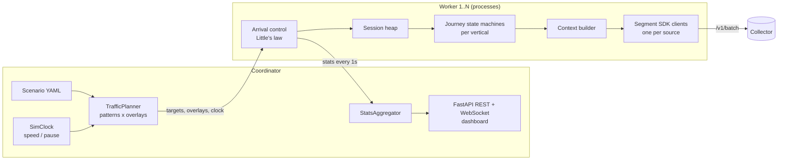

# trafficsim

Application traffic simulator for three product categories. It models concurrent users and their sessions, then sends real
events through the open-source Segment SDK
([`segment-analytics-python`](https://github.com/segmentio/analytics-python)) to any Segment-compatible collector, such as
RudderStack, Jitsu, your own collector, or the bundled mock.

| Vertical | Platforms | Event schema |
|---|---|---|
| Video streaming | web, iOS, Android | [Segment Video Spec](https://segment.com/docs/connections/spec/video/) |
| E-commerce | web, iOS, Android | [Segment E-commerce Spec](https://segment.com/docs/connections/spec/ecommerce/v2/) |
| Gaming | PC, PS5 | Custom game event set |

Every event's `context` (library, device, os, app, network, screen, userAgent, locale, timezone, ip) matches its source
platform. Web events look like `analytics.js`, apps like `analytics-ios` / `analytics-android`, and PC/PS5 like a C# SDK
inside the game client. Web uses `page`, apps and consoles use `screen`, and actions use `track`. Anonymous users who
sign in or sign up get `identify` (plus `alias` on signup).

## Quick start

```bash
uv venv --python 3.12 .venv     # any Python >= 3.11 works (tested on 3.15)
uv pip install --python .venv/bin/python -e '.[dev]'
source .venv/bin/activate

trafficsim mock-collector                       # terminal 1: local Segment-compatible endpoint on :8088
trafficsim serve                                # terminal 2: dashboard on http://127.0.0.1:8000
trafficsim run ecom_flash_sale --max-wall 60    # or run headless from the CLI
```

Other commands:

```bash
trafficsim list                       # bundled scenarios
trafficsim validate                   # validate every scenario (or: trafficsim validate my.yaml)
trafficsim run mixed_all --speed 120 --concurrency 20000 --start-at -24h --set verticals.gaming.weight=0.5
trafficsim run stress_100k --dry-run  # simulate without sending anything
pytest                                # tests (spin up a real mock collector in-process)
```

Each run writes `runs/<run-id>/summary.json` and `timeseries.csv`. If `sample_payloads` > 0, it also writes
`payloads-w*.jsonl` with a sample of the exact payloads sent.

## How it works



- **Cohorts**: a cohort is a (vertical, platform, region) combination. Its target concurrency is
  `base_concurrency × vertical weight × platform share × region share × patterns × overlays`.
- **Arrivals**: each worker owns a hash shard of every cohort. It starts sessions with a Poisson arrival rate that tracks
  the target, using departures plus a correction term (Little's law). Session lengths are lognormal (`mean_minutes`,
  `sigma`, min/max). With warm start, a run begins at the target concurrency instead of ramping up from zero.
- **Journeys**: each session walks a weighted Markov state machine defined in its vertical's catalog, including
  playback heartbeats, ads, carts, checkout and matches. Scenario events bias transition weights; for example, a flash
  sale raises add-to-cart and checkout probability.
- **Identity**: users come from a seeded, deterministic pool per cohort with stable anonymousId/userId/traits, country,
  locale and device. Returning users keep their identity across sessions within a run.
- **Emission**: there is one SDK `Client` per source (vertical × platform) per worker, using the source's write key.
  - The SDK handles batching, consumer threads, retries/backoff, gzip, auth and `sentAt`.
  - The SDK's `context.library` would otherwise overwrite the platform library, so the platform library is kept.
  - Queue-full drops, upload failures and queue depth are counted and shown. Nothing fails silently.
  - Workers back off when an SDK queue is more than 80% full.

## Dashboard

`trafficsim serve` (default `http://127.0.0.1:8000`) provides:

- **Setup**: pick a scenario, then edit base concurrency, speed, duration, start time, seed, workers, the events/s cap,
  payload sampling and platform mix. You can also edit the full YAML. *Validate* shows the planned peak.
- **Live controls**: pause/resume, stop, change speed, and trigger any scenario event (flash sale, premiere,
  tournament...) immediately with an optional magnitude and hold time.
- **Charts**: active sessions by vertical/platform against the target; events/s by call type; SDK sent/failed/dropped
  rates and queue depth; funnels (playback, ads, purchase, match, store); the busiest events; active overlays and sim
  clock.
- **Exports**: summary JSON and timeseries CSV for the current run (generated on demand), and links to past runs.

API: `GET /api/meta`, `GET /api/scenarios[/{id}]`, `POST /api/validate`, `POST /api/runs`
(`{"scenario": id | "yaml": text, "overrides": {"dotted.key": value}, "dry_run": bool}`), `GET /api/runs/current`,
`POST /api/runs/current/{pause|resume|stop}`, `POST /api/runs/current/speed {"speed": 60}`,
`POST /api/runs/current/events {"type": "flash_sale", "magnitude": 3, "hold": "30m"}`,
`GET /api/runs/current/export/{summary.json|timeseries.csv}`, `GET /api/runs`, and WebSocket `/ws`. The WebSocket sends
a `hello` with the recent series, then `point` once per second, then `finished`.

## Destinations and write keys

`config/destinations.example.yaml` is used unless `config/destinations.yaml` exists (that file is gitignored). Values
support `${ENV_VAR:-default}`:

```yaml
host: ${SEGMENT_HOST:-http://localhost:8088}       # SDK posts to {host}/v1/batch
default_write_key: ${SEGMENT_WRITE_KEY:-dev-write-key}
sources:                                           # "<vertical>_<platform>" → "<vertical>" → default
  ecom_ios: ${ECOM_IOS_WRITE_KEY:-}
  gaming_ps5: ${GAMING_PS5_WRITE_KEY:-}
```

Keep real keys in the environment or in the gitignored file, never in a committed file. `--host` (CLI) and
`trafficsim serve --host` override the collector URL. Typical hosts are a RudderStack data plane (`http://<dp>:8080`), a
Jitsu Segment-compatible endpoint, or the bundled `trafficsim mock-collector` (`GET :8088/stats`, `GET /sample`,
`POST /reset`).

## Authoring scenarios

Scenarios live in `scenarios/*.yaml`. Any field can be overridden with `--set dotted.key=value` or from the dashboard.

```yaml
name: My launch day
start_at: now            # now | -24h | +1h | 2026-11-27T00:00:00Z
duration: 12h
speed: 60                # 1 = real time, 60 = one simulated hour per wall-clock minute
seed: 42                 # reproducible users and journeys
workers: null            # default: min(CPUs, peak/1500)
events_per_sec_cap: null # optional global throttle
sample_payloads: 0.001   # fraction of payloads written to runs/<id>/payloads-w*.jsonl
sdk: {upload_size: 100, upload_interval: 0.5, max_queue_size: 50000, threads: 1, gzip: false}
traffic:
  base_concurrency: 10000
  regions: {us: 0.45, eu: 0.30, apac: 0.15, latam: 0.05, india: 0.05}   # drives timezone + locale/country
  patterns:              # multiplicative; each may be scoped with verticals/platforms/regions
    - {type: diurnal, floor: 0.1}                       # per-vertical 24h curve in each region's local time
    - {type: weekly, factors: [1, 1, 1, 1, 1.1, 1.3, 1.25]}
    - {type: ramp, from: 0.2, to: 1, duration: 30m}
    - {type: spike, at: +2h, rise: 5m, hold: 20m, decay: 30m, magnitude: 3, platforms: [ios]}
    - {type: step, initial: 1, steps: [{at: +6h, value: 0.5}]}
    - {type: sine, period: 1h, amplitude: 0.1}
    - {type: custom, points: [[0s, 1], [1h, 2], [2h, 1]], repeat: 2h}
verticals:
  streaming:
    weight: 0.5
    platforms: {web: 0.3, ios: 0.35, android: 0.35}
    session: {mean_minutes: 35, sigma: 0.9, min_minutes: 0.5, max_minutes: 300}
    event_names: {playback_started: "Playback Began"}   # rename any catalog event
    params: {titles: 500}                                # override catalog params
  gaming: {weight: 0.5}
events:                  # scenario event overlays
  - {type: game_launch, at: +1h, magnitude: 6}
  - {type: tournament, at: +5h, hold: 2h, platforms: [pc]}
  - {type: custom, vertical: ecom, at: +3h, magnitude: 2, bias: {add_to_cart: 2}, featured: {coupon: SPRING}}
```

**Scenario events** have a rise/hold/decay envelope. While active, they multiply concurrency for their scope, bias
journey transitions, and feature content in event properties. Any preset field (`rise`, `hold`, `decay`, `magnitude`,
`platforms`, `regions`, `bias`, `featured`) can be overridden.

| Vertical | Event types |
|---|---|
| Streaming | `premiere` (spike, plays shift to a featured title), `live_event` (sharp ramp, long hold, livestream) |
| E-commerce | `flash_sale` (spike, conversion boost, sale SKUs and coupon), `black_friday` (multi-day elevation), `campaign_push` (iOS/Android push burst with campaign context) |
| Gaming | `game_launch` (huge ramp, installs, tutorials, first sessions), `patch_day` (login/update spike), `tournament` (matchmaking surge), `weekend_event` (double XP) |
| Any | `custom` (requires `vertical`) |

Bundled scenarios:
- `baseline_streaming`, `baseline_ecom`, `baseline_gaming`
- `streaming_premiere`, `ecom_flash_sale`, `ecom_black_friday` (starts at `-4d`), `gaming_launch_day`,
  `gaming_tournament`, `mixed_all`
- `stress_100k` (100k concurrent sessions at 60x)

### Catalogs: events, properties, journeys

`catalogs/{streaming,ecom,gaming}.yaml` define, for each vertical:
- the app identity
- `events` (logical key → event name)
- `funnels`
- the `journey`

A journey is a set of states, each with:
- an optional `view` (`page` on web, `screen` on apps)
- `track` events
- `dwell` seconds
- weighted `next` transitions

Special states use handlers in `trafficsim/verticals/*.py` for playback, checkout and matches. State names are also the
keys that scenario-event `bias` multiplies. Point a scenario at your own copy with `verticals.<v>.catalog: path.yaml`.
To rename events without forking a catalog, use `verticals.<v>.event_names`.

## Timestamps

- An event's `timestamp` is the **simulated** time, anchored at `start_at`. `sentAt` is the real wall-clock time the SDK
  sent the batch.
- **Accelerated runs** (`speed` > 1) starting at `now` produce timestamps that move into the future: a 2-hour scenario
  at 60x finishes 2 hours ahead after 2 wall minutes.
  - Collectors that skew-correct with `sentAt` (Segment, RudderStack) will shift these events back towards real time.
    That correction is wrong for a simulation.
  - Some warehouses also reject future events.
- **To get realistic historical data**, start in the past so the simulated clock never overtakes the wall clock, for
  example `start_at: -24h` with `duration: 24h` (as `ecom_black_friday` does with `-4d`). Disable skew correction in the
  collector if possible.
- **Real-time runs** (`speed: 1`, `start_at: now`) have `timestamp ≈ sentAt` and are safe for any pipeline.
- The mock collector reports the median `sentAt - timestamp` skew in `/stats`.

## Scale and throughput

Measured on a 10-core laptop, with the mock collector on the same machine:

- `stress_100k` with 10 workers held 100k concurrent sessions (peak 101.5k) at 60x for the 2-hour scenario (about 2 wall
  minutes).
  - It sent 12.8M events at an average of about 101k events/s (peak about 112k/s).
  - All 12.8M were received by the collector, with 0 failed and 0 dropped.
  - Workers ran a steady ~350 simulated seconds (~6 wall seconds) behind the clock, because the box was CPU-bound with
    the collector competing for cores. Event timestamps stay exact either way.
  - The dashboard shows this as *Sim lag*.
- One worker generates roughly 10k+ events/s through the SDK. Event volume scales with
  `concurrency × speed`: 100k sessions at real time is about 1.7k events/s, and the same at 60x is about 100k events/s.
- If lag grows, use more workers or machines, a lower `speed`, `events_per_sec_cap`, or larger `sdk.upload_size` /
  `sdk.threads`. Dropped events mean an SDK queue overflowed. Raise `sdk.max_queue_size` or slow down. Drops are always
  reported.
- When a run stops, workers drain SDK queues for up to 60 s before exports are written.

## Layout

```
trafficsim/   clock, config, patterns, planner, events (overlays), identity, contexts, journeys,
              verticals/{streaming,ecom,gaming}.py, scheduler, worker, emitter (Segment SDK), stats,
              runner (coordinator), export, api/app.py, dashboard/, mock_collector.py, cli.py
catalogs/     event names, properties, journeys, funnels per vertical
scenarios/    bundled scenarios
config/       destinations.example.yaml
tests/        pytest suite
```
