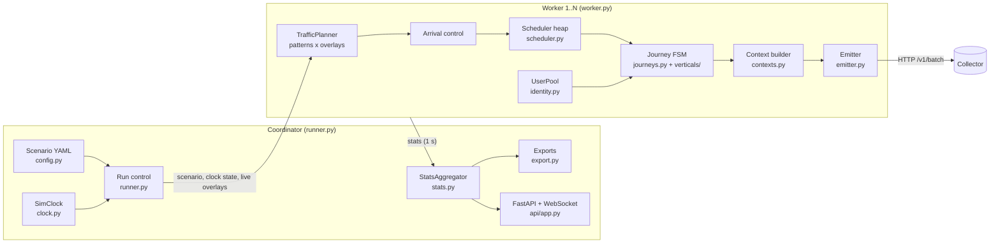
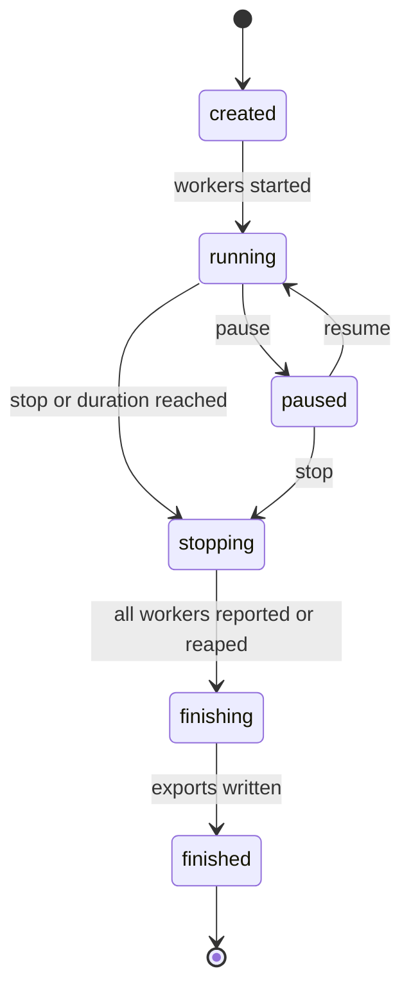

# Architecture

trafficsim has one coordinator process and N worker processes. The coordinator decides *how many* sessions each cohort
should have at every simulated instant. Workers decide *what those sessions do* and send the resulting events through
the Segment SDK.

## Coordinator

| Module | Responsibility |
|---|---|
| `config.py` | Locates scenarios/catalogs/config, loads YAML strictly (no aliases), validates the `Scenario` model, resolves destinations and write keys. |
| `timeutil.py` | Parses durations (`90s`, `1h30m`, `2d`) and start times (`now`, `-24h`, ISO-8601). |
| `clock.py` | `SimClock`: maps wall time to sim time with a speed multiplier, pause/resume and live speed changes. Uses `time.monotonic`, which is system-wide, so every process agrees on the anchor and NTP adjustments cannot make sim time jump. |
| `patterns.py` | Composable multiplicative traffic shapes (constant, diurnal, weekly, ramp, step, spike, sine, custom). |
| `events.py` | Scenario-event overlays: presets with a rise/hold/decay envelope, a concurrency multiplier, journey bias and featured content. |
| `planner.py` | `TrafficPlanner`: target concurrency and overlay effects per cohort `(vertical, platform, region)` at sim time *t*. Also estimates the run's peak to size workers. |
| `runner.py` | Starts workers, broadcasts clock changes (pause, resume, speed) and live overlays, records a stats point every wall second, handles stop, drain and reaping, writes exports. |
| `stats.py` | Thread-safe aggregation: per-second series, events by type/name/platform, funnels, SDK health. |
| `export.py` | `summary.json`, and `timeseries.csv` built from the `timeseries.jsonl` written during the run. |
| `api/app.py` | REST, WebSocket fan-out and the static dashboard, with same-origin checks, CSP and request limits. |

## Worker

Each worker builds its own `TrafficPlanner` from the scenario and owns a hash shard of every cohort, so `n` workers each
carry `1/n` of every target.

1. **Arrival control.** Every 0.25 wall seconds, or every 15 sim seconds at high speeds (whichever comes first), the
   worker compares each cohort's active sessions with its share of the target. Over the elapsed window `dt` it starts a
   Poisson number of sessions with mean `departure_rate × dt + (target − active) × min(1, dt / arrival_tau_seconds)`,
   where `departure_rate` is a smoothed observed rate seeded from `target / mean_session_length` (Little's law). The
   gain is capped at 1 so a long window (a busy worker) cannot over-correct. Starts never take a cohort more than 15 %
   above target. If a cohort is more than 15 % above target (for example after a spike ends),
   the excess sessions are told to end; they still emit their exit events and are counted as `sessions_trimmed`.
2. **Warm start.** With `warm_start: true` the run begins at target concurrency, with first steps spread over 60 sim
   seconds. Warm sessions get a length-biased residual lifetime, so they end at the rate a steady-state population
   would. Without this, the whole warm cohort would end together around the mean session length.
3. **Scheduling.** `Scheduler` is a min-heap of `(next_event_sim_time, session_id)` plus an index of live entries.
   Rescheduling or discarding a session leaves a stale heap entry that is skipped when popped.
4. **Journeys.** Each session runs a generator over its vertical's journey: a weighted Markov chain of states. A state
   emits a view (`page` on web, `screen` elsewhere) and `track` events, then waits a dwell time. Some states call a
   handler (playback, checkout, match, login). Overlay `bias` multiplies transition weights by target state name.
5. **Identity.** `UserPool` is a seeded pool per cohort of about `user_pool_factor` × the cohort's peak concurrency.
   A user is never in two sessions at once. If the pool is exhausted, overflow users are minted and later reused, so
   the pool is bounded by peak concurrency. State that should outlive a session (signed up, installed games) is
   persisted per user.
6. **Context.** `contexts.py` builds a platform-accurate Segment `context`: library, device, OS (never older than the
   device's launch OS), app, screen, network, userAgent, locale, timezone and IP.
7. **Emission.** `Emitter` routes events to one `SimClient` per source (vertical × platform), each with its own write
   key. See [SDK accounting](#sdk-accounting).
8. **Backpressure.** While any SDK queue is more than 80 % full, the worker stops generating until it drains. The lag
   this causes is reported as `max_lag_sim_seconds`; event timestamps stay exact.

## Sim time

Every event's `timestamp` is the session's simulated time, never the wall clock. Workers process all events due at or
before `clock.now()`. If a worker falls behind, timestamps remain correct and the dashboard shows *Sim lag*.

See [operations.md#timestamps](operations.md#timestamps) for how this interacts with collectors.

## SDK accounting

`segment-analytics-python` is used unmodified as a dependency. `emitter.py` subclasses two classes:

- **`SimClient(Client)`** is constructed with `send=False`, so the SDK neither starts its own consumer nor registers an
  `atexit` join. It then starts counted `SimConsumer` threads on the same queue. `_enqueue` keeps the platform's own
  `context.library`, which the SDK would otherwise overwrite with `analytics-python`.
- **`SimConsumer(Consumer)`** counts events in `request()` only after the SDK's retrying upload succeeds. It overrides
  `next()` to acknowledge (`task_done`) and count messages over 32 KB. Upstream drops those without acknowledging them,
  which makes any `queue.join()`-style drain hang.

Every event generated ends in exactly one bucket:

| Counter | Meaning |
|---|---|
| `sent` | Accepted by the collector (HTTP 2xx, after retries). |
| `failed` | Upload gave up after `sdk.max_retries` (reported by the SDK's `on_error`). |
| `dropped` | SDK queue was full at enqueue time. |
| `oversize` | Message larger than 32 KB, Segment's per-message limit. |
| `undelivered` | Still queued when the drain deadline passed at stop. |

## Run lifecycle

On stop, workers stop generating, drain their SDK queues for up to `drain_timeout` (60 s), send final stats and exit.
Workers still alive `drain_timeout + 15 s` after the stop are terminated and the run records an error.
